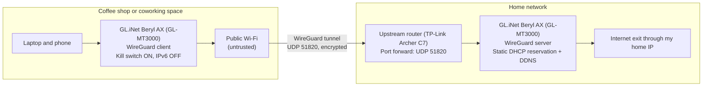

# Project 01: Self-Hosted WireGuard VPN for Public Wi-Fi

## Summary

I work from coffee shops and coworking spaces. Those networks are open to anyone in the room, and I have no idea who runs them or what they log. I built a self-hosted WireGuard VPN so my traffic leaves my laptop encrypted and exits through my home internet connection. No commercial VPN company sits in the middle.

The setup uses two GL.iNet travel routers. One stays at home as the WireGuard server. The other comes with me in my bag as the client. My laptop and phone join the travel router's Wi-Fi, never the coffee shop's network directly.

## Architecture



## Hardware and software

| Item | Role |
|------|------|
| GL.iNet Beryl AX (GL-MT3000) | WireGuard server at home |
| GL.iNet Beryl AX (GL-MT3000) | WireGuard client I carry with me |
| TP-Link Archer C7 | Home upstream router, handles the port forward |
| WireGuard | VPN protocol, managed through the GL.iNet admin panel and LuCI |
| GL.iNet DDNS | Keeps a stable hostname as my home public IP changes |
| Chrome Remote Desktop | Remote access for configuration while away from home |

## Build steps

1. **Set up the home server router.** Enabled the WireGuard server on UDP port 51820, generated the key pair, and created a peer profile for the travel router. Turned on IP masquerading so tunnel traffic leaves through my home connection.
2. **Locked the server's address on the home network.** Created a static DHCP reservation on the upstream router, tied to the server router's MAC address. The port forward needs a fixed target.
3. **Forwarded one port.** Forwarded UDP 51820 on the upstream router to the reserved address.
4. **Set up dynamic DNS.** Residential public IPs change. GL.iNet DDNS gives the client a hostname to dial instead of a raw IP.
5. **Opened forwarding in the firewall.** In LuCI, set the `wgserver` zone's Forward policy to ACCEPT so traffic from the tunnel reaches the internet.
6. **Configured the travel router as the client.** Imported the peer profile, pointed the endpoint at the DDNS hostname on port 51820, removed the IPv6 endpoint, turned the kill switch on, and turned IPv6 off.
7. **Tested from outside the home network.** Used a phone on cellular data to confirm the external IP resolved to my home connection before trusting the setup on public Wi-Fi.
8. **Documented everything.** Kept reference documents with configs, addresses, and troubleshooting steps, plus a fallback remote-access guide using Tailscale.

## Daily use

1. Plug in the travel router at the table and join the venue's Wi-Fi from the router's admin page (or through the venue's captive portal).
2. Wait for the WireGuard tunnel to show connected.
3. Connect the laptop and phone to the travel router's Wi-Fi only.
4. If the tunnel drops, the kill switch blocks traffic until the tunnel comes back.

## Client profile structure (sanitized)

Every value below is a placeholder. Real keys never go in this repo.

```ini
[Interface]
PrivateKey = <REDACTED>
Address = 10.0.0.2/32
DNS = <DNS_SERVER>

[Peer]
PublicKey = <SERVER_PUBLIC_KEY>
Endpoint = <DDNS_HOSTNAME>:51820
AllowedIPs = 0.0.0.0/0
PersistentKeepalive = 25
```

`AllowedIPs = 0.0.0.0/0` sends all IPv4 traffic through the tunnel. With IPv6 off and the kill switch on, nothing leaves the client outside the tunnel.

## Problems I hit and what I learned

- **TCP port checkers lie about WireGuard.** Sites like canyouseeme.org test TCP. WireGuard runs on UDP, so the checker reported the port closed while the forward was fine. I wasted troubleshooting time on a false negative. Now I test UDP services with UDP tools, or test the tunnel directly.
- **One eero unit will not bridge a third-party router.** A single eero needs other eero units to mesh and does not extend a non-eero router while giving you a wired port. The right tool is a Wi-Fi extender with an Ethernet port.
- **Home upload speed sets the ceiling.** Tunnel throughput depends on my home connection's upload speed (around 10 to 35 Mbps), not the download speed at the coffee shop. Enough for video calls and browser-based tools.
- **Self-hosted beats a managed service for this use.** Cloud options overlap in features but add a vendor dependency. I keep control of keys, uptime, and logs.
- **Plan remote recovery before you need it.** For out-of-band reboots while away, a smart plug on the server works only if the plug joins the ISP gateway's Wi-Fi. If the plug joins the router it powers, a router failure takes the plug offline too.

## Control mapping

| What I did | NIST CSF 2.0 | CIS Controls v8 | Reason |
|------------|--------------|-----------------|--------|
| WireGuard encryption for all traffic on public Wi-Fi | PR.DS (Data Security) | CIS 3: Data Protection | Nobody on the venue network reads my traffic |
| Devices join the travel router, never the venue Wi-Fi | PR.IR (Technology Infrastructure Resilience) | CIS 12: Network Infrastructure Management | My devices sit behind my own router and firewall on an untrusted network |
| Kill switch on the client | PR.DS (Data Security) | CIS 3: Data Protection | The client fails closed. If the tunnel drops, traffic stops instead of leaking |
| IPv6 disabled on the client | PR.PS (Platform Security) | CIS 4: Secure Configuration | Removes a path around the tunnel |
| Single UDP port forward for the tunnel | PR.IR (Technology Infrastructure Resilience) | CIS 12: Network Infrastructure Management | Keeps the inbound exposure on my home network to one service |
| Static DHCP reservation and DDNS hostname | ID.AM (Asset Management) | CIS 1: Inventory of Enterprise Assets | The server has a known, documented address |
| Written configs and troubleshooting log | ID.AM (Asset Management) | CIS 4: Secure Configuration | A documented baseline to rebuild from |
| Tailscale fallback guide | RC.RP (Incident Recovery Plan Execution) | CIS 11: Data Recovery | A second way in if the primary tunnel fails |
| Self-hosted instead of a VPN vendor | GV.SC (Supply Chain Risk Management) | CIS 15: Service Provider Management | One less third party in the trust chain |
| Cellular test before trusting the setup | ID.IM (Improvement) | n/a | Verified the control works from outside, not from inside the network |

## Open gaps

Tracked in the [risk register](../docs/risk-register.md): the SPI firewall on the home upstream router is off (R-02), the home server has no recovery path while I'm away (R-03), and weak venue Wi-Fi drops the tunnel during calls (R-07).
