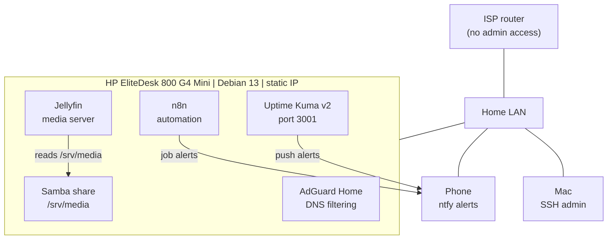

# Project 02: Homelab Server (Debian 13 + Docker)

## Summary

A used HP EliteDesk 800 G4 Mini became my first server. I bought the machine for under a $250 budget, installed Debian 13, and run every service in Docker. The server sits on my home network and handles DNS filtering, media, workflow automation, and uptime monitoring. I manage everything over SSH from my Mac.

One constraint shaped the build: I have no admin access to my ISP's router. DHCP reservations and port forwards are off the table, so every network decision happens on the server itself.

## Architecture



## Hardware and software

| Item | Detail |
|------|--------|
| Hardware | HP EliteDesk 800 G4 Mini, Intel i5-8500, 16 GB RAM, 256 GB NVMe |
| OS | Debian 13, hostname `homelab` |
| Addressing | Static IP set in `/etc/network/interfaces` |
| Containers | Docker Compose, one folder per service under `~/docker/<service>` |
| Services | AdGuard Home, Jellyfin, n8n, Uptime Kuma v2 |
| File sharing | Samba share on `/srv/media` |
| Alerting | ntfy push notifications to my phone |

## Build steps

1. **Picked the hardware.** Compared a used Lenovo ThinkCentre M920q Tiny against the HP EliteDesk 800 G4 Mini. Chose the EliteDesk for the price and easy RAM upgrades.
2. **Installed Debian 13** and set the hostname to `homelab`.
3. **Set a static IP on the server.** With no access to the ISP router, a DHCP reservation was not an option. I set the address in `/etc/network/interfaces` so services stay at a known address.
4. **Set up SSH** and moved all administration to my Mac terminal.
5. **Installed Docker and Compose.** Each service gets a folder under `~/docker/<service>` with its own `docker-compose.yml`. One service breaking does not touch the others, and each config sits in one predictable place.
6. **Deployed AdGuard Home** for network-wide DNS filtering.
7. **Created a Samba share** at `/srv/media` with a dedicated share user.
8. **Deployed Jellyfin** and mounted the same folder as `/media`, so files dropped into the share show up in the media library.
9. **Deployed n8n** and built a published workflow that scans job postings and pushes matches to my phone through its own ntfy topic.
10. **Deployed Uptime Kuma v2** on port 3001 to watch every service, with alerts to my phone through ntfy.

## Network config (sanitized)

```text
# /etc/network/interfaces (placeholder values)
auto <INTERFACE>
iface <INTERFACE> inet static
    address <SERVER_IP>/24
    gateway <GATEWAY_IP>
    dns-nameservers <DNS_SERVER>
```

## Service layout

```text
~/docker/
├── adguard/        docker-compose.yml
├── jellyfin/       docker-compose.yml
├── n8n/            docker-compose.yml
└── uptime-kuma/    docker-compose.yml
```

## Example compose file (Uptime Kuma)

```yaml
services:
  uptime-kuma:
    image: louislam/uptime-kuma:2
    container_name: uptime-kuma
    restart: unless-stopped
    ports:
      - "3001:3001"
    volumes:
      - ./data:/app/data
```

## Problems I hit and what I learned

- **No router access means the server owns its network identity.** A static IP set on the host works, but the ISP router does not know about the address. A DHCP lease to another device on the same address would cause a conflict. Uptime Kuma alerts me if the server drops off the network, and the risk sits in the register.
- **One folder per service pays off.** Backups, updates, and troubleshooting all start at `~/docker/<service>`. No hunting for config files.
- **Monitoring belongs in the first build.** Without Uptime Kuma, the first sign of a dead service would be a failed movie night or a missed job alert. Now my phone tells me first.
- **Pick an alert channel you already check.** I skipped Telegram and went with ntfy because the app stays on my phone and needs no account.

## Control mapping

| What I did | NIST CSF 2.0 | CIS Controls v8 | Reason |
|------------|--------------|-----------------|--------|
| Documented hardware, OS, addresses, and services | ID.AM (Asset Management) | CIS 1: Inventory of Enterprise Assets | You protect what you know about |
| Listed every running service and its port | ID.AM (Asset Management) | CIS 2: Inventory of Software Assets | Each container and port has an owner and a reason |
| Static address set on the host | PR.PS (Platform Security) | CIS 4: Secure Configuration | Services sit at a known, documented address |
| One isolated container per service | PR.PS (Platform Security) | CIS 4: Secure Configuration | Limits the blast radius of one bad update or misconfiguration |
| Remote administration over SSH only | PR.AA (Identity Management, Authentication, and Access Control) | CIS 12: Network Infrastructure Management | Encrypted admin access, no console needed |
| DNS filtering with AdGuard Home | PR.PS (Platform Security) | CIS 9: Email and Web Browser Protections | Blocks ad, tracker, and known-bad domains for every device on the LAN |
| Uptime Kuma with push alerts | DE.CM (Continuous Monitoring) | CIS 8: Audit Log Management | Outages reach me in minutes |
| Dedicated Samba share user | PR.AA (Identity Management, Authentication, and Access Control) | CIS 5: Account Management | Share access runs through its own account |

## Open gaps

Tracked in the [risk register](../docs/risk-register.md): single disk with no backups (R-04), possible address conflict on the ISP network (R-05), no patch schedule for the OS and containers (R-06), and admin panels reachable from any device on the LAN (R-08).
